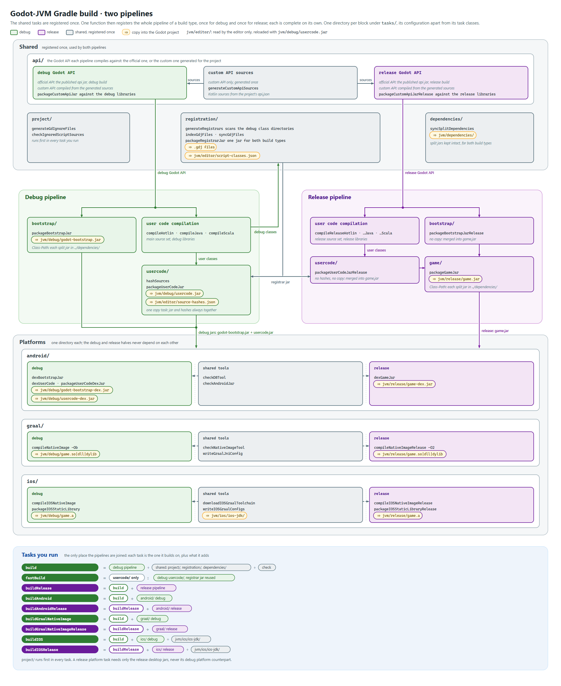

# The Gradle plugin

The Gradle plugin builds every artifact described in [the build artifacts](artifacts.md). Its tasks fall into three groups:

- **Shared tasks**, registered once and used by both build types: hiding build output from Godot, choosing the Godot API, registration, and the split dependency jars.
- **Two pipelines**, one per build type. The same code registers both, and each is complete on its own, from the compilation to the jars and the platform artifacts of its build type.
- **The tasks you run**, such as `build` and `buildRelease`. They are the only place where the two pipelines are joined.

Each block of the diagram is a directory under the plugin's `tasks/`, with its task classes apart from the code that registers and wires them. A copy into the Godot project (⇒) is a task of its own, so a build rewrites only the files that changed.

## Two build types

Godot-JVM publishes a debug and a release build of its runtime libraries. They differ in more than the jars a game ships: `GodotJvmBuildConfig.DEBUG` is a compile-time constant, and inline library functions such as `VariantArray<T>()` copy their debug checks into the code that calls them. Code compiled against the debug libraries therefore carries debug checks, even when packed with the release libraries, so each pipeline compiles the project's sources on its own:

| | Debug | Release |
|---|---|---|
| Source set | `main` | `release`, the same source directories as `main` |
| Libraries | `debug` variants of `com.utopia-rise:godot-jvm` | `release` variants |
| Compilation | `compileKotlin`, `compileJava`, `compileScala` | `compileReleaseKotlin`, `compileReleaseJava`, `compileReleaseScala` |
| Jars | `build/libs/debug/` | `build/libs/release/` |
| Godot project | `jvm/debug/` | `jvm/release/` |

The `com.utopia-rise.godot.build-type` attribute selects the library variant: every resolvable configuration asks for `debug`, except the release source set's classpaths, the release configurations of the plugin (`bootstrapRelease`, `godotGameRuntimeClasspathRelease`) and the release custom API compilation. Each task of a build type has its own inputs and outputs, so a build of one type never invalidates the other.

During an IntelliJ IDEA sync only the debug pipeline is registered, with no `release` source set, since IntelliJ keeps a source directory shared by two source sets in only one of its modules.

## Shared tasks

A task is shared when its output does not depend on the build type:

- **The Godot API.** `api/` gives each pipeline the Godot API it compiles against. The official API is the published `api` jar of that build type. A custom API is generated once from `api.json`, then compiled once per build type, since the generated API calls the same inline library functions as the published one.
- **Registration.** The ClassGraph scan reads class and member signatures, which both compilations produce identically, so `generateRegistrars` scans the classes of the debug compilation. The generated registrars call only the bootstrap library, which never reads `DEBUG`, so the registrar jar is compiled once and both `usercode.jar` builds include it.
- **Split dependencies.** The `godotSplitImplementation` and `godotSplitRuntimeOnly` jars are the same for both build types. They are kept once in `jvm/dependencies/`, which the `Class-Path` of both `jvm/debug/godot-bootstrap.jar` and `jvm/release/game.jar` lists as `../dependencies/`. Only desktop JVM exports use this directory: Android dexes the split jars into `godot-bootstrap-dex.jar` or `game-dex.jar` and native images compile them in, reading the split classpath directly without waiting for this copy. Next to them, `split-dependencies.txt` names the jars the build uses, one per line, and a desktop JVM export packs only those.
- **Project and tools.** Hiding build output from Godot, warning about hidden source directories, and the Android, GraalVM and iOS tool checks serve both pipelines.

## Files the editor reads

`jvm/editor/` holds what only the editor reads: `source-hashes.json`, the MD5 of every source the debug `usercode.jar` was compiled from. Godot does not index the directory, and an export never packs it. The editor reads it whenever it loads `jvm/debug/usercode.jar`, never on its own. `copyUserCode` writes the hashes and the jar in one task, and any change rewrites both, so the hashes always describe the jar the editor runs.

## Tasks you run

Each task you run is the task it builds on, plus what it adds:

| Task | Is | Writes |
|---|---|---|
| `build` | The debug pipeline, the shared tasks and Gradle's `check` | `jvm/debug/godot-bootstrap.jar`, `jvm/debug/usercode.jar`, `jvm/editor/`, `jvm/dependencies/`, the `.gdj` files |
| `fastBuild` | The debug `usercode/` only, reusing the last registrar jar | `jvm/debug/usercode.jar`, `jvm/editor/source-hashes.json` |
| `buildRelease` | `build` + the release pipeline | `jvm/release/game.jar` |
| `buildAndroid` | `build` + the debug Android tasks | `jvm/debug/godot-bootstrap-dex.jar`, `jvm/debug/usercode-dex.jar` |
| `buildAndroidRelease` | `buildRelease` + the release Android tasks | `jvm/release/game-dex.jar` |
| `buildGraalNativeImage` | `build` + the debug native image | `jvm/debug/game.<so, dll or dylib>` |
| `buildGraalNativeImageRelease` | `buildRelease` + the release native image | `jvm/release/game.<so, dll or dylib>` |
| `buildIOS` | `build` + the debug iOS library | `jvm/debug/game.a`, `jvm/ios/ios-jdk/` |
| `buildIOSRelease` | `buildRelease` + the release iOS library | `jvm/release/game.a`, `jvm/ios/ios-jdk/` |

Every release task runs `build`, so a release build always brings up to date what the editor loads; when the debug build is current, that costs only Gradle's up-to-date checks and rewrites nothing. A release platform task needs only the release desktop jars, never its debug platform counterpart: `buildAndroidRelease` does not dex the debug jars.

In [library mode](../../reference/gradle-plugin/packaging-and-tasks.md#islibrary), only the `api/` tasks remain: `build`, `buildRelease` and `fastBuild` build the plain library jar, compiled once against the debug libraries, and the Android, GraalVM and iOS tasks fail.

## Every task

A task name ending in `Release` is the release counterpart of the task without the suffix, registered by the same code. The tasks below are those the plugin registers; Gradle's own (`compileKotlin`, `check`, `test`...) keep their usual meaning.

### `project/`

| Task | Does |
|---|---|
| `generateGdIgnoreFiles` | Writes the `.gdignore` files that hide `build/`, `gradle/`, `jvm/editor/` and the embedded JREs from Godot. Runs with every task you run and after `clean`. |
| `checkIgnoredScriptSources` | Warns when a `.gdignore` file hides a script source directory from Godot, since scenes then cannot load its classes. |

### `api/`

| Task | Does |
|---|---|
| `generateCustomApiSources` | Custom API only: generates the Kotlin sources of the Godot API from `api.json`, once for both build types. |
| `packageCustomApiJar`, `packageCustomApiJarRelease` | Custom API only: packs the generated API, compiled by `compileCustomApiKotlin` (`compileCustomApiReleaseKotlin`) against the libraries of its build type, into the jar that build type compiles against. With the official API, the published `api` jar takes its place. |

### `registration/`

| Task | Does |
|---|---|
| `generateRegistrars` | Scans the debug classes and their classpath, then generates the registrar sources, their service file, the staged `.gdj` files. Skipped by `fastBuild`. |
| `indexGdjFiles` | Indexes the `.gdj` files already in the Godot project, wherever the user moved them. |
| `syncGdjFiles` | Updates the indexed `.gdj` files in place, removes the obsolete ones and adds the new ones to the registration directory. |
| `packageRegistrarJar` | Packs the registrars, compiled once by `compileRegistrarsKotlin`, into the jar both `usercode.jar` builds include. |

### `dependencies/`

| Task | Does |
|---|---|
| `writeSplitDependencyList` | Writes `split-dependencies.txt`, the file names of the split jars. |
| `syncSplitDependencies` | Makes `jvm/dependencies/` hold exactly the split jars, intact, and `split-dependencies.txt`. A jar the open editor still holds stays until the next change of split dependencies; neither a `Class-Path` nor the list names it any more, so nothing loads or exports it. |

### `bootstrap/`

| Task | Does |
|---|---|
| `packageBootstrapJar`, `packageBootstrapJarRelease` | Packs the Godot-JVM libraries, the Godot API and the project's ordinary dependencies into `godot-bootstrap.jar`, with its `Class-Path` listing the split jars. |
| `copyBootstrapJar` | Copies the debug bootstrap jar to `jvm/debug/godot-bootstrap.jar`. The release one is only merged into `game.jar`. |

### `usercode/`

| Task | Does |
|---|---|
| `hashSources` | Writes the MD5 of every source in the debug build's source directories inside the Godot project. |
| `packageUserCodeJar`, `packageUserCodeJarRelease` | Packs the compiled classes, the registrar jar and the `godotGame*` dependencies into `usercode.jar`. |
| `copyUserCode` | Copies the source hashes to `jvm/editor/source-hashes.json` and the debug jar to `jvm/debug/usercode.jar`, both rewritten whenever either changes. |

### `game/`

| Task | Does |
|---|---|
| `packageGameJar` | Release only: merges the release bootstrap and user code jars into `game.jar`, service files merged, with its `Class-Path` listing the split jars. |
| `copyGameJar` | Copies it to `jvm/release/game.jar`. |

### `android/`

| Task | Does |
|---|---|
| `checkD8Tool`, `checkAndroidJar` | Check the configured d8 tool and `android.jar` before any dexing. |
| `dexBootstrapJar` | Dexes the debug bootstrap jar with the split jars into `godot-bootstrap-dex.jar`. |
| `dexUserCode` | Dexes the debug `usercode.jar` against the bootstrap jar. |
| `packageUserCodeDexJar` | Packs those dex files with the non-class entries of `usercode.jar` into `usercode-dex.jar`. |
| `copyDexJars` | Copies both to `jvm/debug/godot-bootstrap-dex.jar` and `jvm/debug/usercode-dex.jar`. |
| `dexGameJar` | Dexes `game.jar` with the split jars into `game-dex.jar`. |
| `copyDexJarsRelease` | Copies it to `jvm/release/game-dex.jar`. |

### `graal/`

| Task | Does |
|---|---|
| `checkNativeImageTool` | Checks the configured GraalVM `native-image` tool. |
| `writeGraalJniConfig` | Writes the JNI configuration Godot-JVM itself needs in a native image. |
| `compileNativeImage`, `compileNativeImageRelease` | Compiles the jars of the build type and the split jars into a shared library, in quick build mode (`-Ob`) for debug and fully optimized (`-O2`) for release. |
| `copyNativeImage`, `copyNativeImageRelease` | Copy it to `jvm/<debug or release>/game.<so, dll or dylib>`. |

### `ios/`

| Task | Does |
|---|---|
| `downloadIOSGraalToolchain` | Downloads the iOS static JDK libraries and the CAP cache and checks them against their checksums. |
| `writeIOSGraalConfigs` | Writes the native-image configurations Godot-JVM needs on iOS. |
| `syncIOSJdk` | Copies the iOS JDK libraries, shared by both build types, to `jvm/ios/ios-jdk/`. |
| `compileIOSNativeImage`, `compileIOSNativeImageRelease` | Compiles the jars of the build type and the split jars into an iOS native-image object file. |
| `packageIOSStaticLibrary`, `packageIOSStaticLibraryRelease` | Packs that object file into `game.a`. |
| `copyIOSStaticLibrary`, `copyIOSStaticLibraryRelease` | Copy it to `jvm/<debug or release>/game.a`. |

### Outside the build

| Task | Does |
|---|---|
| `installAddon` | Replaces the project's `addons/jvm/` with the addon of the plugin's own version. |
| `generateEmbeddedJre` | Builds the embedded JRE of the host from the project's Java toolchain; on macOS, `generateEmbeddedJreArm64` and `generateEmbeddedJreAmd64` build each architecture. |
