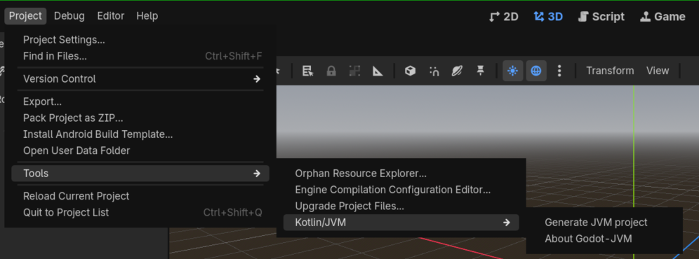
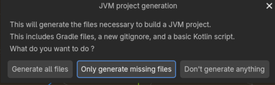
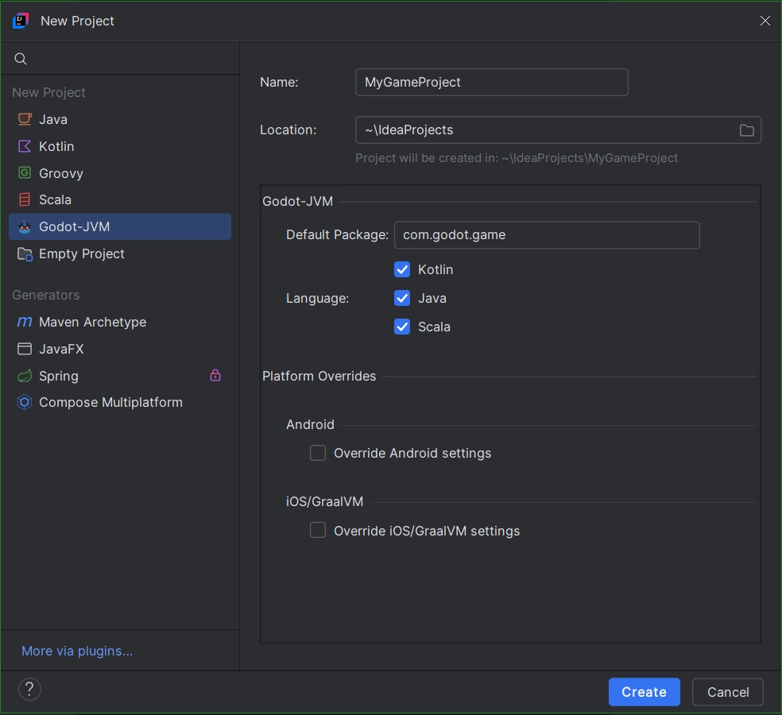
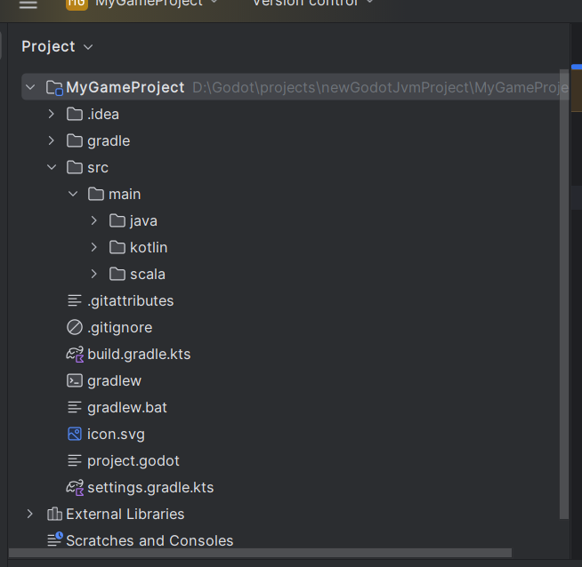
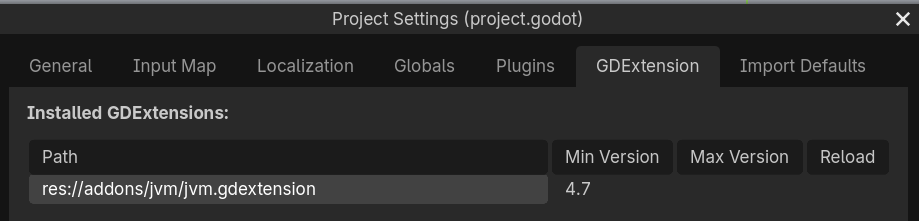

# Create a project

A Godot-JVM project is a regular Godot project with three additions: the addon under `addons/jvm/`, a Gradle build, and source directories for your scripts. There are three ways to get there. Pick one; they all produce the same layout.

- **Godot editor**: you add the addon to a Godot project, new or old, from Godot's asset store or a GitHub release, and the editor adds the Gradle build and source directories.
- **IntelliJ IDEA wizard**: the IDE creates a brand new project, Godot files and Gradle build included, and a Gradle task installs the addon.
- **Template project**: you clone a complete project that already contains everything, addon included.

## Option 1: Godot editor

Use this when you already have a Godot project, or when you prefer to create a plain Godot project first and add JVM support to it.

1. Create a fresh project in Godot, or open an existing one.
2. Add the addon to the project, either way:
    - from Godot's asset store, where Godot-JVM is published from its 1.0.0 release on: search for Godot-JVM and install it;
    - from [GitHub releases](https://github.com/utopia-rise/godot-jvm/releases): download `godot-jvm-addon-<version>.zip` and extract it at the project's root, preserving its `addons` directory.

    Either way, the manifest ends up at `addons/jvm/jvm.gdextension`, next to the native library of every supported platform. Godot picks it up when the project is opened or reloaded.

3. Select **Project > Tools > Kotlin/JVM > Generate JVM project**.

    

4. Review the files the dialog will generate.

    

5. Click **Only generate missing files**, the default button. It adds the Gradle build and source directories and leaves every existing file in place.
6. Open the project directory in IntelliJ IDEA to edit your scripts.

!!! warning
    **Generate all files** overwrites existing generated project files. Use **Only generate missing files** to preserve your build configuration.

## Option 2: IntelliJ IDEA wizard

Use this when you want to start a brand new project from your IDE. The wizard generates the Godot project files, the Gradle build, and the source directories in one step, so there is nothing to create in Godot first.

Install the **Godot-JVM** plugin in **Settings > Plugins > Marketplace** (listed under its previous name, Godot Kotlin/Jvm, until the 1.0.0 plugin release). Restart the IDE if prompted.

1. Choose **New Project > Godot-JVM**.
2. Enter **Name**, **Location**, and **Default Package**, then choose the languages to enable. Kotlin, Java, and Scala are enabled by default.
3. Leave **Platform Overrides** unchecked for this desktop walkthrough.
4. Click **Create**.
5. Run the `installAddon` Gradle task, from the Gradle tool window under **godot-jvm** or with `./gradlew installAddon` at the project's root. It downloads the addon matching the Gradle plugin version and installs it in `addons/jvm/`.



!!! warning
    Choose a new, empty directory. The wizard overwrites files such as `project.godot`, `icon.svg`, and Git configuration files; do not run it on an existing Godot project. To add JVM code to an existing project, use the Godot editor option instead.



## Option 3: Template project

Use this when you want a complete, ready-to-run project without generating anything. The [Godot-JVM project template](https://github.com/utopia-rise/godot-jvm-project-template) already contains the Godot project files, the Gradle build, the source directories, and the addon.

1. Clone or download the template repository.
2. Rename the project in `project.godot` and adjust the package name in the source directories to match your game.
3. Open the directory in Godot and in IntelliJ IDEA.

Because the addon is bundled, there is nothing to install. Its version matches the Gradle plugin version in the template's `build.gradle.kts`.

## Keep the addon in sync

The addon's native libraries and the JVM libraries the Gradle plugin builds with must come from the same Godot-JVM version; Godot-JVM refuses to start with mismatched ones. Whichever option you chose, when you change the plugin version in `build.gradle.kts`, run `./gradlew installAddon` to replace `addons/jvm/` with the matching addon. It deletes the previous addon's files first, and a running Godot editor needs a restart to load the new one.

## Check that the addon is loaded

Open the project in Godot `4.7.2` or newer, then select **Project > Project Settings > GDExtension**. Confirm that `res://addons/jvm/jvm.gdextension` is listed and enabled.



The toolbar also gains a **Run Gradle** button and a JVM status indicator once the extension is loaded.

## Generated Gradle configuration

The generated `build.gradle.kts` uses defaults for settings that were not selected in the wizard:

```kotlin
import godot.gradle.GodotLanguage

plugins {
    id("com.utopia-rise.godot-jvm") version "<godot-jvm-version>"
}

repositories {
    mavenCentral()
}

godot {
    languages.set(setOf(GodotLanguage.KOTLIN, GodotLanguage.JAVA, GodotLanguage.SCALA))
    isGodotCoroutinesEnabled.set(true)
}
```

This example enables every language and coroutines. See the [Gradle options index](../reference/gradle-plugin/index.md) for Android, GraalVM, registration, and toolchain settings.

## The resulting layout

Whichever option you chose, you end up with the same project. The Godot and Gradle projects share one root directory, so the build files and the `src/` directory sit alongside `project.godot`:

```text
MyGameProject/
├── addons/
│   └── jvm/                  # the Godot-JVM GDExtension addon
│       └── jvm.gdextension
├── src/
│   └── main/
│       ├── kotlin/            # present if Kotlin is enabled
│       ├── java/              # present if Java is enabled
│       └── scala/             # present if Scala is enabled
├── build.gradle.kts
├── settings.gradle.kts
├── gradlew / gradlew.bat
├── gradle/                     # Gradle wrapper files
├── project.godot
├── jvm/                        # debug/ and release/ JARs and the embedded JRE
├── gdj/                        # dependency registration files
├── godot_jvm_configuration.json # runtime settings, written on first editor launch
└── build/                      # Gradle output, excluded from exports
```

Write your scripts under `src/main/` in the folder for their language. Keep the addon in `addons/jvm/`, and run Gradle commands from the root directory containing `gradlew` and `gradlew.bat`.

Some entries appear only later: the build and the first editor launch create `jvm/`, `build/`, and `godot_jvm_configuration.json`, and `gdj/` appears only when a dependency contributes registered classes.

Your Godot-JVM project is ready. The next page walks you through writing, building, and attaching your first script.
