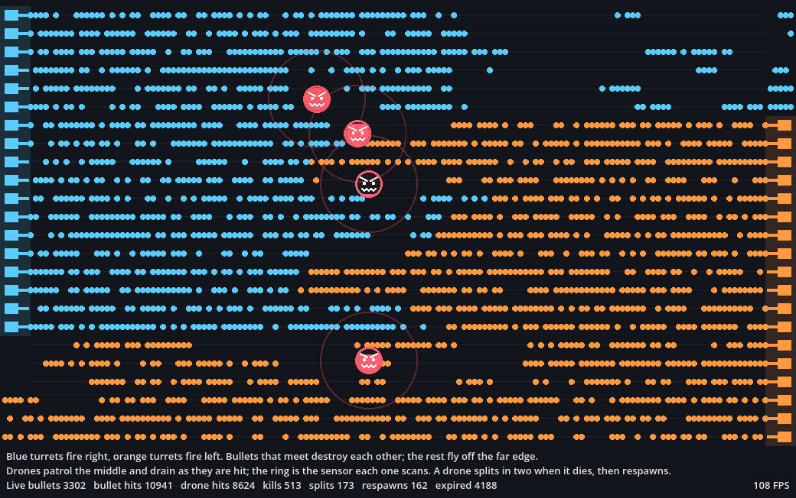

# Bulletmark

A benchmark of the binding paths that a 2D game hits on every frame: objects spawned and freed, a
physics-process script per entity, engine-to-JVM signal dispatch from physics, tweens, timers and lambda callables,
deferred calls, and scene queries that return arrays of objects.

## Quick start

Build the native library into `harness/tests` first (see the repository's build instructions), then:

```bash
./gradlew importResources                       # build the Kotlin side and import the project; again after every change
./gradlew runBulletmark -Plabel=base            # measure in a window: about 25 s, report in results/base.json
./gradlew runBulletmark -Pheadless -Plabel=base # measure without a window
./gradlew watchBulletmark                       # watch it play in real time
```

To compare two builds of Godot-JVM, see [Comparing two builds](#comparing-two-builds).

## The scene

Two turret lines face each other and fire into partly shared lanes. Each bullet is an `Area2D` with its own Kotlin
script; it moves in `_physics_process`, learns about hits through `area_entered`, and frees itself on its first hit or
when its lifetime runs out. In the shared middle lanes bullets meet head-on, in the outer lanes they cross the arena and
expire.

Twelve drones patrol the middle of the arena, one script class doing everything the enemy side of a game would:

| Drone behaviour | Binding path it exercises |
|---|---|
| Patrols diagonally, crossing the lanes | A second per-entity `_physics_process` next to the bullets' |
| Every 15 frames, walks the bullets inside its sensor ring and the drones in its group, then steers away from close drones and speeds up the more bullets its ring holds | `getOverlappingAreas` and `getNodesInGroup`, each element delivered to the JVM as an object, then a `position` read per drone |
| Is hit through its own `area_entered` and flashes | A second signal per hit, and a two-step `Tween` |
| On death, splits into two smaller drones | `callDeferred`, because the engine refuses new areas during a collision signal |
| Respawns half a second after dying | A `SceneTreeTimer` whose timeout runs a lambda through `connectLambda` |

Every kill is recorded in a score `Dictionary`. The two drones a split leaves have a third of the hit points and
neither split nor respawn, so the population stays bounded. The arena looks up its `Bullets` and `Drones` containers
with `getNode` by name every frame.

Bullets are drawn either as a `Sprite2D` child each (`-Prender=nodes`, the default) or by the arena in one `_draw`
(`-Prender=draw`). Both modes play the same game.



Blue turrets stand on the left and fire right; orange turrets stand on the right and fire left. Each side covers 18 of
the 24 lanes: in the 12 middle lanes both sides fire and the streams meet head-on, destroying each other; in the top and
bottom lanes only one side fires, so those bullets cross the whole arena and expire off the far edge.

The drones are the red faces in the middle of the arena, each inside its sensor ring. They keep their distance from each
other, so they spread across the middle, and move faster the more bullets fly through their ring, up to twice their
calm speed. A drone's colour drains from the top as it loses hit points, leaving it dark when it is about to die. The bottom three lines are the legend and live
counts, with a frame counter in the bottom right corner.

The drain is shown only in a window: a headless run skips that engine call on every hit, so it stays out of headless
measurements.

## Running

Every task needs a Godot 4 editor. It uses `GODOT_EDITOR` when set, otherwise the standard macOS install at
`/Applications/Godot.app` or a `godot` command on the `PATH`, and says how to set it when it finds none:

```bash
export GODOT_EDITOR=/Applications/Godot.app/Contents/MacOS/Godot
```

The native library comes from `harness/tests/addons/jvm`, so build it there first. Then run `importResources` once and
again after every Kotlin change: `runBulletmark` does not rebuild the jars, and refuses to run when the Kotlin or C++
sources are newer than the build it would measure.

Options are Gradle properties named after the runner's options, for example
`./gradlew runBulletmark -Plabel=draw -Prender=draw -Pframes=2400`; [Options](#options) lists them all.

### Window or headless

`runBulletmark` measures in a window, like bunnymark, so you can see what is measured. It plays the game at a fixed
60 fps of game time, as fast as the machine allows, so the window shows the game in fast forward. `-Pheadless` measures
the same game without a window. Both are steady; the window only costs more per frame, because every frame also
renders. The FPS counter in the corner therefore shows how many frames per second the machine computes, about 110 at
9.2 ms a frame, rather than a 60 fps target:

| Three runs each | p50 frame | Spread of p50 | p99 frame |
|---|---|---|---|
| Window (`runBulletmark`) | 9.15 to 9.25 ms | 1.0% | 11.4 to 11.6 ms |
| Headless (`runBulletmark -Pheadless`) | 5.49 to 5.70 ms | 3.8% | 7.9 to 8.3 ms |

Use `-Pheadless` when comparing builds of the binding: without the rendering, the binding takes a larger share of the
frame, so the same saving shows as a larger percentage. A report records which mode it ran in, and a window run is
never compared with a headless one.

### Watching

`./gradlew watchBulletmark` opens a window and plays for a minute in real time, as does pressing Play in the Godot
editor. It takes the same options, and `-Pscreenshots=400,800` saves those frames to `results/screenshots/`, read from
the game's own viewport. A real-time run is for looking at, not for measuring: each frame advances the game by however
long it took, so the game plays out differently every time.

## How a run is measured

Godot runs with `--fixed-fps 60`: every frame advances the game by exactly 1/60 s however long it takes to
compute, and every random choice comes from one seeded generator, so every run simulates the same game. Two runs of
the same build spawn, hit and kill exactly the same things; only the frame times differ.

The runner discards the warm-up frames, then records the wall time of each measured frame, from one runner call to
the next: physics, scripts, signals, tweens, timers and the binding's per-frame memory sync included. It reports p50,
p95, p99, p99.9, the worst frame and the mean, plus the live bullet count and the game's totals. It also counts the
hitches, frames longer than 16.7 ms, one frame's budget at 60 fps, and lists at which measured frames they happened:
p50 says how fast a typical frame is, the hitches how often the game would stutter.

It also reads the JVM's own counters at the start and the end of the measured frames:

- **Allocated bytes per frame** on the main thread, which runs every script call.
- **Collections and GC time** in the measured window, with the collectors' names.
- **JIT compilation time** in the window. It should stay near zero; at 600 warm-up frames it was over 100 ms, which is
  why the warm-up is 2,400 frames.
- **Script calls per frame**: every time the engine entered the scene's scripts (physics steps, signal handlers,
  draws, deferred calls, timer lambdas), counted by the scripts themselves. The game is deterministic, so this number
  is identical between runs of the same game.

Script calls are exact. Allocation varies by up to about 6% between runs of the same game, so a single run confirms
a large allocation change, and the A/B's median over several runs a smaller one. They need the `java.management` module: runs through `runBulletmark` use the editor's full
JDK, while an exported game whose jlink runtime leaves the module out reports them as unavailable.

## Reference numbers

Apple M4 Pro, macOS 26, Godot 4.7.2 editor binary, debug jars, JDK 21, default options, `-Pheadless`, three runs
(October 2026).

| | Run 1 | Run 2 | Run 3 |
|---|---|---|---|
| p50 frame time | 5,667 µs | 5,700 µs | 5,490 µs |
| p99 frame time | 7,878 µs | 8,183 µs | 8,281 µs |
| Worst frame | 17,930 µs | 19,319 µs | 15,967 µs |
| Allocated per frame | 21.8 KB | 21.8 KB | 21.8 KB |
| Script calls per frame | 3,373.9 | 3,373.9 | 3,373.9 |
| GC in the measured window | 1 young collection, 2 ms | 1, 2 ms | 1, 3 ms |
| JIT compilation in the measured window | 5 ms | 5 ms | 6 ms |

Every run plays the same game: 144,040 bullets spawned, 68,069 bullet-on-bullet hits, 49,863 bullets stopped by
drones, 22,846 expired, 46,338 drone hits, 2,772 kills (1,846 of them split children), 926 splits, 917 respawns and
654 scans walking 32,813 bullets. With `-Prender=draw`, p50 is about 6.7 ms: the arena reads every bullet's position
and draws it, about 3,300 calls of each per frame.

The default load was chosen by profiling the main thread with async-profiler. Kotlin scripts take about 19% of it and
the JVM's entry machinery about 14%, most of that the W^X switch macOS on Apple Silicon makes on every call from
native code into the JVM. Godot and the binding's native side take the rest. Above 40 bullets per frame, frame time
grows faster than the bullet count, which points at physics work growing with density.

## Options

Each option is a Gradle property for `runBulletmark`, `watchBulletmark` and `abBulletmark`. Run directly with Godot,
the same names are runner options after `--`: `-Pframes=600` becomes `--frames=600`. `-Pheadless` is not a runner
option: it tells `runBulletmark` and `abBulletmark` to start Godot without a window.

| Option | Default | Meaning |
|---|---|---|
| `-Plabel=<name>` | `run` | Name of the run, and of its report file |
| `-Plang=kt`, `cs` or `gd` | `kt` | The scene's language, see [Other languages](#other-languages) |
| `-Pwarmup-frames=N` | 2400 | Frames run before measuring, so the JIT has compiled the hot paths |
| `-Pframes=N` | 1200 | Measured frames |
| `-Pseed=N` | 42 | Seed of the arena's random generator |
| `-Pbullets-per-frame=N` | 40 | Bullets spawned every physics frame, split between the two sides |
| `-Plifetime-frames=N` | 150 | Frames before an unhit bullet expires |
| `-Pmax-live=N` | 10000 | Cap on live bullets; spawns past it are skipped and counted |
| `-Prender=nodes` or `draw` | `nodes` | A `Sprite2D` per bullet, or the arena drawing every bullet in one `_draw` |
| `-Phits=on` or `off` | `on` | Off, nothing detects collisions: no `area_entered` signals, no overlap work, no kills |
| `-Preactions=on` or `off` | `on` | Off, no `Tween` per hit, and respawns are counted down by the arena instead of by a timer and lambda |
| `-Pbookkeeping=on` or `off` | `on` | Off, no `getNode` lookups, groups, drone scans or score `Dictionary` |
| `-Pbaseline=<path>` | absent | Compares the frame times with a previous run's report, relative to the project |
| `-Presults-dir=<path>` | `res://results` | Where the JSON report is written |
| `-Pscreenshots=N,M` | absent | Saves those frames as PNG; ignored when headless |
| `-Praw-samples` | absent | Adds every measured frame time to the report |

Results land in `results/<label>.json`: the run's label and commit, every setting with its default filled in, the
machine and Godot version, the frame-time statistics, the live bullet samples and the game's totals.

## Switches

Each switch removes one part of the workload, so a change in frame time can be traced to the subsystem behind it. A
switch changes the game, so its runs are only comparable with runs using the same switches.

| Run with | p50 frame | Allocated per frame | Script calls per frame | What changed |
|---|---|---|---|---|
| defaults | 5.7 ms | 21.8 KB | 3,374 | |
| `-Phits=off` | 5.7 ms | 9.3 KB | 6,013 | No collision work at all, but bullets live their full lifetime: 6,000 live instead of about 3,300 |
| `-Preactions=off` | 5.8 ms | 20.1 KB | 3,346 | No tweens or timers; respawns follow the physics clock, so the game differs slightly |
| `-Pbookkeeping=off` | 5.8 ms | 21.6 KB | 3,419 | No queries or lookups; without scans the drones neither spread out nor panic, so the game differs |
| `-Prender=draw` | 6.7 ms | 127.7 KB | 3,375 | Same game; the arena reads and draws every bullet itself |

One headless run each on the reference machine. Frame times within a few percent of each other are inside the run-to-run
spread; the call counts are exact and allocation varies by a few percent between runs. `-Prender=draw` allocates about one `Vector2` per bullet per frame
more than the defaults: the position each bullet reports to `_draw` is not optimized away.

## Comparing two builds

An A/B compares two builds of Godot-JVM playing the identical game. Each build is frozen into a snapshot of the
project, then the two run alternately so that whatever the machine does during the comparison falls on both.

```bash
# on the baseline: build the native library into harness/tests, then
./gradlew importResources
./gradlew snapshotBuild -Psnapshot=base

# on the change: the same build steps, then
./gradlew importResources
./gradlew snapshotBuild -Psnapshot=change

./gradlew abBulletmark -Pheadless -Pa=base -Pb=change
```

`snapshotBuild` refuses to freeze a build whose jars are older than the Kotlin sources or whose native library is
older than the C++ sources. `abBulletmark` runs five rounds by default, in ABBA order so neither build always goes
first, and writes every report and the verdict to `build/ab/results/<time>/`. Its options are `-Pheadless`
(recommended, see [Window or headless](#window-or-headless)), `-Prounds=N`,
`-Pthreshold=P` (percent, default 2), any runner option such as `-Prender=draw` applied to both sides, and
`-Prejudge=<time>` to judge an earlier comparison again without running.

The verdict compares the two runs of each round with each other, since they ran back to back on the same machine
state. For p50 and the mean, the change is the median of the rounds' changes. It counts as FASTER or SLOWER only when
it exceeds the threshold and at least four rounds in five move the same way; above the threshold without that
agreement it is "not settled", below it "no detectable change". p95, p99, p99.9 and the hitches are reported but
never decide. Allocation, GC and script calls are compared directly, and the comparison is refused when the two builds
used different settings, played out differently or made different numbers of script calls.

| Comparison | p50 | Rounds | Verdict |
|---|---|---|---|
| Two snapshots of the same build | −1.9% | −2.4, +1.5, +1.0, −7.5, −1.9 | no detectable change |
| Fixed-offset frame writes for the `position` setter | −0.9% | −3.3, −0.9, −1.2, +0.4, +0.2 | no detectable change |

The second change removes a few writes from each of the 3,400 or so `position` calls per frame, a few microseconds out
of five milliseconds, so no detectable change is the expected answer.

## Other languages

The scene also exists in C# (`cs/`) and GDScript (`gd/`), run with `-Plang=cs` or `-Plang=gd`. Each is a line-for-line
port of the Kotlin scene: the same random draws in the same order and the same arithmetic, so all three play exactly
the same game, with the same totals and the same 3,373.9 script calls per frame. Comparing a run against a report in
another language with `-Pbaseline` checks that, since the comparison allows a different language but refuses a
different game.

```bash
./gradlew runBulletmark -Pheadless -Plabel=kt
./gradlew runBulletmark -Pheadless -Plang=cs -Plabel=cs -Pbaseline=results/kt.json
./gradlew runBulletmark -Pheadless -Plang=gd -Plabel=gd -Pbaseline=results/kt.json
```

A GDScript run uses the same editor as a Kotlin one; it reports script calls but no allocation or GC counters, since
GDScript frees by reference counting. The GDScript classes are named `GdArena`, `GdBullet` and `GdDrone` because
Godot-JVM registers the Kotlin `Arena`, `Bullet` and `Drone` as global classes. A C# run needs the .NET build of the
Godot editor, found through `GODOT_EDITOR_MONO` or at `/Applications/Godot_mono.app`, and the .NET 8 SDK; every task
that runs C# first builds the scripts with `./gradlew buildCSharp`.

### Language snapshot

Measured on 2026-10-13 with the scene at commit `885b21b4b` (Godot-JVM 1.0.0-rc2), Godot 4.7.2, macOS 26.6 on an Apple
M4 Pro. Each language ran from a release export with its runtime's default settings: the embedded JRE built from
Corretto 21, .NET 8 as Godot exports it, GDScript as is. The numbers describe this workload on this machine at that
time; they are a reference point for Godot-JVM's own changes, not a verdict on the other runtimes.

Three rounds of the three exports in rotated order, each run 2,400 warm-up frames then 10,800 measured frames (three
minutes), headless. Medians in milliseconds:

| Language | p50 | p99 | p99.9 | Worst frame | Hitches over 16.7 ms |
|---|---|---|---|---|---|
| Kotlin | 4.43 | 6.08 | 7.15 | 8.1 to 10.0 | 0 |
| C# | 4.65 | 6.83 | 27.3 | 32.9 to 33.9 | 16 to 18 |
| GDScript | 4.45 | 6.14 | 7.23 | 8.7 to 11.3 | 0 |

All nine runs played the same game. The typical frame is level across the three: the engine's own physics and scene
work dominates it. 

No task makes the exports yet. These were made by hand:

1. Build the native library with `scons platform=macos target=template_release`, then in this project
   `./gradlew syncAddon build -Prelease generateEmbeddedJre`.
2. Copy the project, add a macOS preset (universal, a bundle identifier) and set
   `rendering/textures/vram_compression/import_etc2_astc=true`, which a universal export requires. Leave out the
   Godot-JVM addon, `src/` and `jvm/` for the C# and GDScript exports, and `cs/` for the Kotlin and GDScript ones.
3. Export with `--headless --export-release <preset>`, the .NET editor for C# and the standard one otherwise.
4. Sign again with `codesign --force --deep -s - --options runtime --entitlements <file>`, the entitlements granting
   `com.apple.security.cs.allow-jit` and `com.apple.security.cs.disable-library-validation`: the built-in signer's
   result is rejected by macOS 26.
5. Run `<app>/Contents/MacOS/<name> --headless --fixed-fps 60 -- --lang=<kt|cs|gd> --frames=10800 --results-dir=<dir>`.
